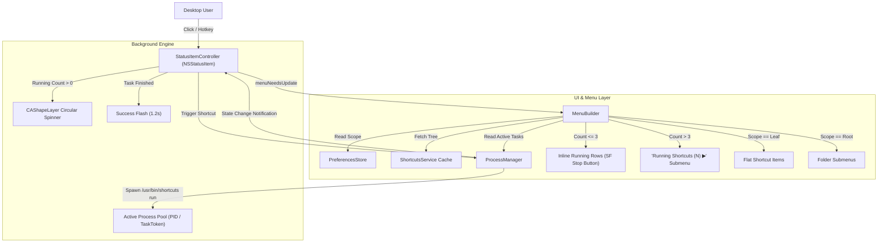
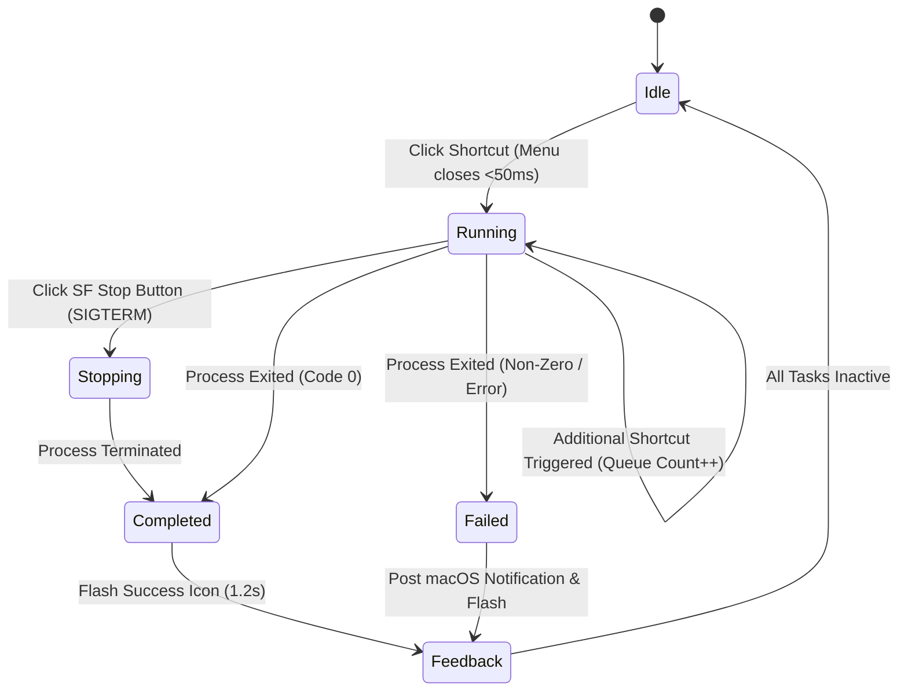

# Feat: Shortcuts Bar Native macOS Menubar Runner

## Goal Capsule

- **Objective**: Deliver a native, lightweight macOS menu bar app that restores the high-efficiency, compact dropdown interaction for Apple Shortcuts, eliminating bloated Control Center popups and providing instant 1-click execution with dynamic progress feedback.
- **Means**: Build a Swift AppKit status bar application (`NSStatusItem` + custom `NSMenu`) that introspects native Apple Shortcuts, adapts its hierarchy to the user-selected scope folder, runs shortcuts in background sub-processes, and manages a concurrent execution queue with HIG-compliant SF Symbol cancellation controls.
- **Product Authority**: Covers the standalone Shortcuts Bar application. Third-party scripting (arbitrary Shell/Python), cloud sync services, and internal block-graph shortcut editing are explicitly excluded from scope.
- **Open Blockers**: None. All core product decisions, interaction models, and HIG adaptations have been settled with the user.

## Product Contract

### Summary

Shortcuts Bar is a native macOS menu bar utility that replaces recent macOS Control Center-style card popups with a classic, ultra-compact vertical dropdown menu. It dynamically reflects the user's Shortcuts folder structure (flat list for a designated leaf folder like "Menu Bar", or hierarchical submenus for the root directory), runs shortcuts instantly in the background with zero UI freeze, displays ScriptMonitor-style circular progress indicators in the menu bar, and offers a concurrent task execution queue that automatically collapses into a submenu when exceeding three concurrent tasks.

### Problem Frame

In recent versions of macOS, Apple redesigned the Shortcuts menu bar item from a native, compact vertical dropdown menu into a floating Control Center-style widget card. This "iPadOS-ification" introduced severe desktop productivity regressions:
1. **Interaction Latency**: Desktop mouse/trackpad users lost the instant `<1s` click-to-run muscle memory; floating cards take space, obscure screen content, and disperse click targets.
2. **Improper Ergonomics**: Large touch-oriented cards sacrifice information density needed on high-precision desktop screens.
3. **Degraded Organization**: Grouping 5–15 high-frequency automation scripts in Control Center widgets produces cluttered cards rather than organized text lists.
4. **Vague Execution Feedback**: The classic circular progress ring (ScriptMonitor) was replaced with vague indicators, reducing confidence in silent background workflows.

### Key Decisions

- **Pure Shortcuts Restoration**: Focus 100% on native Apple Shortcuts rather than building an all-in-one script launcher (session-settled: user-directed — chosen over advanced management center or universal script runner: focus 100% on restoring native Apple Shortcuts experience). *Governs R1, R2, R7.*
- **Folder Scope Model**: Map menu hierarchy directly to Shortcuts' own folder structure based on user-configured scope folder (session-settled: user-directed — chosen over invented groupings: folder structure maps 1:1 to Apple Shortcuts native folders based on user's selected scope folder in settings; leaf folder = flat list, root folder = folder submenus). *Governs R3, R4.*
- **Concurrent Task Queue**: Support multi-task concurrent execution with active task tracking and cancellation in the dropdown menu (session-settled: user-directed — chosen over single static top item or pure icon-only: supports concurrent shortcut execution queue; when clicked during execution, top of menu shows the active executing tasks with individual names, progress indicators, and individual stop buttons). *Governs R5, R6.*
- **Adaptive Task Threshold (>3 Submenu)**: Automatically collapse running tasks into a submenu when exceeding 3 concurrent items (session-settled: user-directed — chosen over always expanding on main menu: when active running tasks count exceeds 3, automatically collapse them into a 'Running Shortcuts (N) ▶' submenu to protect main menu visibility). *Governs R6.*
- **Apple HIG Compliance & Icon-Only Stop**: Adhere strictly to Apple Human Interface Guidelines by using pure SF Symbol buttons (`stop.circle.fill`) without redundant text (session-settled: user-directed — chosen over redundant text labels: adhere strictly to Apple HIG by using pure SF Symbol icon buttons (stop.circle.fill) with no Chinese/English text for stopping tasks). *Governs R5, R8.*
- **Non-Destructive Testing Guarantee**: Automated and manual verification must create dedicated, isolated test shortcuts and never modify, overwrite, or delete existing user shortcuts. *Governs R9.*

### Actors

- **Desktop Power User**: Interacts via mouse click or global keyboard hotkey on the menu bar item; clicks shortcuts to execute them instantly; inspects or halts running tasks.
- **Shortcuts Bar App**: Background status bar process (`LSUIElement = true`); manages cached shortcuts tree, monitors execution state, drives menu animations, and handles signals.
- **macOS Shortcuts Subsystem (`shortcuts` CLI / Daemon)**: Executes the target shortcut asynchronously in background; returns output, errors, and termination status.

### Key Flows

#### 1. Instant Execution Flow (Leaf Folder)
1. User clicks the menu bar icon (or presses global hotkey).
2. App displays compact `NSMenu` populated with shortcuts from the target leaf folder (e.g., "Menu Bar").
3. User clicks shortcut item.
4. Menu instantly dismisses (`<50ms`), yielding UI focus back to active application.
5. App spawns async task in background process pool, updates menu bar icon to spinning progress ring.
6. Upon task completion, menu bar icon flashes success indicator for 1.2s and returns to idle state.

#### 2. Running Queue & Cancellation Flow
1. While one or more tasks are executing, user opens the menu.
2. If active tasks $\le 3$, app renders inline running task rows at the top of the menu with micro spinner, shortcut title, and `stop.circle.fill` SF Symbol button.
3. If active tasks $> 3$, app renders a single top row `⚡ Running Shortcuts (N) ▶` which opens a submenu listing all active tasks plus a "Stop All" action.
4. User clicks the stop button: app issues termination signal (`SIGTERM` / cancel) to the process handle, removes it from queue, and updates the status item.

#### 3. Root Folder Navigation Flow
1. User configures target scope folder to "All Shortcuts" (Root).
2. Clicking status item displays top-level folders as native submenus (with item counts).
3. Hovering over a folder slides out native secondary submenu showing shortcuts within that folder.

### Requirements

#### Core Menu & Hierarchy
- **R1 (Status Bar Item)**: App must live in macOS menu bar as an `NSStatusItem` with a monochrome template icon that automatically adapts to light and dark menu bars.
- **R2 (Instant Execution)**: Clicking a shortcut menu item must dismiss the menu immediately and launch the shortcut asynchronously in the background without blocking the main run loop.
- **R3 (Leaf Scope Flat List)**: When configured to a leaf folder (such as the default "Menu Bar" folder), the menu must present a single-layer flat list of shortcuts adhering to desktop compact height (22–24pt row height).
- **R4 (Root Scope Submenus)**: When configured to root folder, top-level Shortcuts folders must render as native `NSMenuItem` entries with submenus, populating child shortcuts upon hover.

#### Execution Queue & Status Feedback
- **R5 (ScriptMonitor Progress Indicator)**: The menu bar icon must animate a circular spinner during execution and reflect multi-task count via badge or composite glyph.
- **R6 (Adaptive Queue Threshold)**: When active tasks are running, opening the menu must display them at the top. For 1 to 3 tasks, display inline with `stop.circle.fill` buttons; for $>3$ tasks, collapse into a `Running Shortcuts (N) ▶` submenu.
- **R7 (Process Management & Termination)**: App must track running sub-processes by task ID / PID and terminate them cleanly upon user stop request without hanging the application.

#### UI Standards & Preferences
- **R8 (HIG & SF Symbols)**: All glyphs must use Apple SF Symbols (`stop.circle.fill`, `gearshape`, `folder`, `bolt.fill`). Destructive actions must use semantic system red with subdued idle state and hover highlight.
- **R9 (Settings & Non-Destructive Storage)**: Preferences window must allow selecting target scope folder, toggling launch at login, and failure notifications. App data must never alter or delete user shortcuts.

### Scope Boundaries

- **In-Scope**: Native macOS status bar runner, dynamic folder hierarchy mapping, background execution via `shortcuts run`, multi-task progress monitoring, HIG SF Symbol stop controls, settings window, launch at login.
- **Deferred for Later**: Global hotkey custom bindings per individual shortcut, custom icon picker for individual shortcuts.
- **Outside This Product's Identity**: In-app graphical shortcut node editor, universal shell/bash script launcher, Windows/Linux ports.

### Acceptance Examples

- **AE1 (Single Click Run)**: Given the menu bar icon is clicked and the menu displays "Clean Clipboard", clicking it dismisses the menu in $<50\text{ms}$ and begins execution; menu bar shows circular spinning animation.
- **AE2 (Folder Mapping)**: Given user sets folder to "All Shortcuts", opening menu shows folder submenus ("Productivity ▶", "Media ▶") rather than a flat unorganized dump.
- **AE3 (Queue Threshold Collapse)**: Given 4 shortcuts are concurrently running, opening the menu shows a single top row `⚡ Running Shortcuts (4) ▶` that reveals all 4 tasks with SF Symbol stop buttons when hovered.
- **AE4 (Safe Cancellation)**: Given a long-running shortcut is executing, clicking its `stop.circle.fill` button terminates the process within $<200\text{ms}$ and removes it from the active queue.
- **AE5 (Safe Test Isolation)**: Test suite only creates temporary shortcuts prefixed with `ShortcutsBarTest_` and cleans up only those exact shortcuts upon test completion.

## Planning Contract

### Summary

The technical architecture is built directly on Swift 6 with native macOS AppKit and Foundation, requiring zero external dependencies. The app runs as an agent process (`LSUIElement = 1`). A centralized `ShortcutsService` queries `/usr/bin/shortcuts list` with low latency ($\approx 17\text{ms}$) and builds the folder/shortcut model. A thread-safe `ProcessManager` manages concurrent sub-process execution of `/usr/bin/shortcuts run`, maintaining task tokens and supporting graceful `SIGTERM` cancellation. The UI layer consists of `StatusItemController` managing a custom `NSStatusItem.button` with CoreAnimation circular progress layers, and a dynamic `NSMenu` constructed on-demand via `NSMenuDelegate` to fulfill the $\le 3$ inline vs $>3$ submenu adaptive threshold with HIG-compliant SF Symbol stop buttons.

### Product Contract Preservation

Product Contract unchanged. Requirements R1 through R9 and Acceptance Examples AE1 through AE5 map 1:1 to Implementation Units U1 through U7.

### Assumptions

- **Host Environment**: macOS 14.0+ (Sonoma or Sequoia) on Apple Silicon arm64 with Xcode 15+ / Swift 6.4.
- **CLI Dependency**: `/usr/bin/shortcuts` is pre-installed on macOS 12+ and accessible without special sandbox entitlements for an unsigned/developer-signed agent app.
- **Build System**: Standard Swift Package Manager (`swift build -c release`) bundled into a self-contained `.app` structure (`ShortcutsBar.app`).

### Key Technical Decisions

- **KTD1 (AppKit NSStatusItem + NSMenu over pure SwiftUI)**: Built using `NSStatusItem` and `NSMenu` rather than SwiftUI `MenuBarExtra`. Pure SwiftUI `MenuBarExtra` cannot host custom interactive `NSView` items inside menu rows with animated micro-spinners and inline stop buttons, nor does it provide deterministic `menuNeedsUpdate` hooks without UI stutter. *Governs R1, R5, R6.*
- **KTD2 (Native CLI Interop over Private SQLite)**: Shortcuts discovery and execution uses `/usr/bin/shortcuts` CLI (`list --folders`, `list --folder-name`, and `run`). This avoids private SQLite schema corruption across macOS updates and executes with native permissions. *Governs R2, R3, R4, R7.*
- **KTD3 (ProcessManager with Concurrency & Cancellation)**: Spawns `/usr/bin/shortcuts run "<name>"` as asynchronous `Process` instances tracked in an actor/thread-safe dictionary. Cancellation issues `process.terminate()`, safely disconnecting pipes. *Governs R5, R6, R7.*
- **KTD4 (ScriptMonitor CAShapeLayer Animation)**: In `NSStatusItem.button`, animate an arc `CAShapeLayer` with `CABasicAnimation(keyPath: "transform.rotation")` at 60fps, avoiding main thread CPU churn. *Governs R5.*
- **KTD5 (Adaptive Running Task Threshold)**: When constructing the menu in `menuNeedsUpdate`: if running tasks $\le 3$, insert custom `RunningTaskMenuView` rows directly at the top; if $>3$, create a single `NSMenuItem` titled `Running Shortcuts (N)` with an attached `NSMenu` submenu containing the task rows and a "Stop All" item. *Governs R6.*
- **KTD6 (Non-Destructive Test Sandbox)**: Automated testing verifies process execution, queue state transitions, and menu construction using mocked process runners and simulated shortcuts, or creates isolated shortcuts strictly matching `ShortcutsBarTest_<UUID>` and cleans them up immediately. Existing user shortcuts are never modified, edited, or deleted. *Governs R9, AE5.*

### High-Level Technical Design



#### Task State Machine



### Output Structure

```text
ShortcutsBar/
├── Package.swift
├── Sources/
│   └── ShortcutsBar/
│       ├── App/
│       │   ├── AppDelegate.swift
│       │   └── main.swift
│       ├── Models/
│       │   ├── RunningTask.swift
│       │   ├── ShortcutItem.swift
│       │   └── ShortcutsFolder.swift
│       ├── Services/
│       │   ├── PreferencesStore.swift
│       │   ├── ProcessManager.swift
│       │   └── ShortcutsService.swift
│       ├── UI/
│       │   ├── MenuBuilder.swift
│       │   ├── RunningTaskView.swift
│       │   ├── SettingsView.swift
│       │   ├── SettingsWindowController.swift
│       │   └── StatusItemController.swift
│       └── Utilities/
│           ├── LaunchAtLoginHelper.swift
│           └── ScriptMonitorSpinnerView.swift
└── Tests/
    └── ShortcutsBarTests/
        ├── MenuBuilderTests.swift
        ├── ProcessManagerTests.swift
        ├── ShortcutsServiceTests.swift
        └── SafeIntegrationTests.swift
```

## Implementation Units

### U1. Scaffolding & Core Models

- **Goal**: Establish the SPM package configuration, executable structure, and foundational immutable data models (`ShortcutItem`, `ShortcutsFolder`, `RunningTask`, `FolderScope`).
- **Requirements**: R1, R8, AE1.
- **Dependencies**: None.
- **Files**:
  - `Package.swift`
  - `Sources/ShortcutsBar/Models/ShortcutItem.swift`
  - `Sources/ShortcutsBar/Models/ShortcutsFolder.swift`
  - `Sources/ShortcutsBar/Models/RunningTask.swift`
  - `Sources/ShortcutsBar/Models/FolderScope.swift`
- **Approach**:
  1. Configure `Package.swift` with `.macOS(.v14)` platform target, swift-tools-version 5.9+.
  2. Implement `ShortcutItem` with `id`, `name`, `folderName`.
  3. Implement `ShortcutsFolder` with `name`, `shortcuts: [ShortcutItem]`.
  4. Implement `RunningTask` with `id: UUID`, `shortcutName: String`, `startTime: Date`, `process: Process?`.
  5. Implement `FolderScope` enum (`root`, `leaf(folderName: String)`).
- **Test scenarios**:
  - `ShortcutItem` JSON/string equality and hashing for menu lookup.
  - `RunningTask` duration calculation and immutable state copying.

### U2. Shortcuts Service & Introspection

- **Goal**: Implement `ShortcutsService` to query `/usr/bin/shortcuts list --folders` and `/usr/bin/shortcuts list --folder-name <name>`, maintaining an in-memory cache with async refresh.
- **Requirements**: R3, R4, AE2.
- **Dependencies**: U1.
- **Files**:
  - `Sources/ShortcutsBar/Services/ShortcutsService.swift`
- **Approach**:
  1. Execute `/usr/bin/shortcuts list --folders` to retrieve all folder names.
  2. For each folder, retrieve child shortcuts via `shortcuts list --folder-name <folder>`.
  3. Also retrieve shortcuts with `shortcuts list --folder-name none` (unfiled shortcuts).
  4. Provide synchronous cache read with asynchronous background refresh, returning in $<25\text{ms}$.
  5. Provide search/filter capability by folder scope.
- **Test scenarios**:
  - Parsing multi-line output into structured `ShortcutsFolder` and `ShortcutItem` collections.
  - Graceful handling of empty folders or CLI execution timeouts.
  - Correct categorization of leaf folder vs root hierarchy.

### U3. Process Execution & Concurrent Queue Manager

- **Goal**: Implement `ProcessManager` to concurrently launch, track, and terminate `/usr/bin/shortcuts run "<name>"`.
- **Requirements**: R2, R5, R6, R7, AE1, AE4.
- **Dependencies**: U1.
- **Files**:
  - `Sources/ShortcutsBar/Services/ProcessManager.swift`
- **Approach**:
  1. Thread-safe manager (Actor or DispatchQueue-synchronized) holding `activeTasks: [UUID: RunningTask]`.
  2. `launch(shortcutName:) -> UUID`: spawns `/usr/bin/shortcuts run "<name>"`, assigns PID, registers completion handler.
  3. `terminate(taskId: UUID)`: calls `task.process?.terminate()` (`SIGTERM`), unregisters PID, updates state in $<50\text{ms}$.
  4. `terminateAll()`: iterates all running tasks and terminates each.
  5. Broadcasts active task list changes to main thread listeners (status item and menu builder).
- **Test scenarios**:
  - Concurrent launches: launching 4 tasks simultaneously correctly tracks 4 distinct task IDs.
  - Clean termination: calling `terminate(taskId:)` triggers termination handler and clears task from active set.
  - Process exit codes: non-zero exit codes emit failure status without crashing the manager.

### U4. Status Bar Controller & ScriptMonitor Animation

- **Goal**: Create `StatusItemController` to manage the `NSStatusItem`, draw the template icon, and drive the ScriptMonitor circular progress animation via `CAShapeLayer`.
- **Requirements**: R1, R5, R8, AE1.
- **Dependencies**: U1, U3.
- **Files**:
  - `Sources/ShortcutsBar/UI/StatusItemController.swift`
  - `Sources/ShortcutsBar/Utilities/ScriptMonitorSpinnerView.swift`
- **Approach**:
  1. Initialize `NSStatusBar.system.statusItem(withLength: NSStatusItem.variableLength)`.
  2. Provide custom view on status button with two visual layers:
     - Base layer: monochrome template shortcuts icon.
     - Spinner layer: circular arc `CAShapeLayer` with continuous 360-degree rotation animation.
     - Multi-task indicator: numeric badge or pulsing ring when active count $>1$.
  3. Support completion flash: on all tasks completed, display green checkmark flash for 1.2s, then transition smoothly back to idle.
- **Test scenarios**:
  - State transitions: `idle -> running(1) -> running(4) -> completed -> idle`.
  - Icon responds properly to dark/light menu bar appearance changes without color inversion bugs.

### U5. Dynamic Native Menu Controller & Running Task Views

- **Goal**: Build `MenuBuilder` and custom `RunningTaskView` with HIG-compliant SF Symbol `stop.circle.fill` buttons and adaptive $>3$ submenu collapse.
- **Requirements**: R2, R3, R4, R6, R8, AE1, AE2, AE3, AE4.
- **Dependencies**: U1, U2, U3, U4.
- **Files**:
  - `Sources/ShortcutsBar/UI/MenuBuilder.swift`
  - `Sources/ShortcutsBar/UI/RunningTaskView.swift`
- **Approach**:
  1. In `MenuBuilder.buildMenu(scope:activeTasks:service:processManager:)`:
     - **Queue Section**:
       - If `activeTasks.count == 0`: no queue rows.
       - If `1 <= activeTasks.count <= 3`: insert an inline `NSMenuItem` for each task with a custom `RunningTaskView` hosting the task title, micro-spinner, and icon-only `stop.circle.fill` button (no redundant text).
       - If `activeTasks.count > 3`: insert a single `NSMenuItem` titled `"Running Shortcuts (\(count))"`, attaching an `NSMenu` submenu containing all tasks + a `"Stop All Tasks"` item.
       - Append a separator if queue is non-empty.
     - **Shortcuts Section**:
       - If `scope == .leaf`: flat list of shortcuts.
       - If `scope == .root`: folder submenus with child shortcuts.
     - **System Section**:
       - Separator + `"Open Shortcuts App..."` + `"Preferences..."` + `"Quit Shortcuts Bar"`.
  2. Clicking shortcut executes `processManager.launch(...)` and closes menu immediately ($<50\text{ms}$).
- **Test scenarios**:
  - Queue $\le 3$: menu contains exact inline task views.
  - Queue $> 3$: menu contains 1 top-level item with submenu holding the tasks.
  - Stop button click: triggers `processManager.terminate(taskId:)`.
  - Leaf scope produces flat menu items; root scope produces submenus.

### U6. Settings Window & Launch-At-Login

- **Goal**: Build native SwiftUI `SettingsView` and `PreferencesStore` using `UserDefaults` and `SMAppService.mainApp` for launch-at-login.
- **Requirements**: R9.
- **Dependencies**: U1, U2.
- **Files**:
  - `Sources/ShortcutsBar/Services/PreferencesStore.swift`
  - `Sources/ShortcutsBar/UI/SettingsView.swift`
  - `Sources/ShortcutsBar/UI/SettingsWindowController.swift`
  - `Sources/ShortcutsBar/Utilities/LaunchAtLoginHelper.swift`
- **Approach**:
  1. `PreferencesStore` manages: `selectedFolderScope: String` (defaults to `"Menu Bar"` if present, otherwise `"All Shortcuts"`), `launchAtLogin: Bool`, `notifyOnFailure: Bool`.
  2. `SettingsView`: SwiftUI Form with Folder Picker, Launch at Login Toggle, Failure Notification Toggle.
  3. `LaunchAtLoginHelper`: calls `SMAppService.mainApp.register()` / `unregister()`.
  4. Changes in folder scope immediately notify `MenuBuilder` to rebuild menu on next open.
- **Test scenarios**:
  - Persisting and reading folder scope settings.
  - Setting invalid folder falls back safely to root without crashing.

### U7. Test Suite & Safe Verification Harness

- **Goal**: Comprehensive automated unit and integration tests, guaranteeing zero destruction/modification of existing user shortcuts.
- **Requirements**: R9, AE5.
- **Dependencies**: U1, U2, U3, U4, U5, U6.
- **Files**:
  - `Tests/ShortcutsBarTests/MenuBuilderTests.swift`
  - `Tests/ShortcutsBarTests/ProcessManagerTests.swift`
  - `Tests/ShortcutsBarTests/ShortcutsServiceTests.swift`
  - `Tests/ShortcutsBarTests/SafeIntegrationTests.swift`
- **Approach**:
  1. Unit tests for parsing, queue state transitions, threshold triggers, and preference persistence.
  2. Integration tests: verify `shortcuts list` output against live system without modifying anything.
  3. Safe test harness: if any test creates a shortcut, it MUST use name `ShortcutsBarTest_<UUID>` and execute automatic `defer { cleanup }`. Ensure baseline shortcut count before test equals count after test.
- **Test scenarios**:
  - `testQueueThresholdTransition`: 1, 2, 3 items inline; 4 items submenu.
  - `testProcessTermination`: simulate long task and verify cancellation within 200ms.
  - `testNonDestructiveIntegrity`: assert existing user shortcuts are untouched.

## Verification Contract

### Automated Test Suite
- Command: `swift test`
- All tests in `ShortcutsBarTests` must pass with zero failures.

### Safety Verification Gate
- Record initial `shortcuts list` output before any test.
- Run test suite.
- Re-run `shortcuts list` and verify exact equality (no shortcuts added, deleted, or altered).

### Manual Smoke Test Checklist
1. Launch built app `ShortcutsBar.app`.
2. Verify menu bar icon appears immediately with sharp template glyph.
3. Click menu bar icon: menu pops up with $<50\text{ms}$ latency.
4. Click a shortcut: menu dismisses instantly; menu bar icon animates circular progress ring.
5. Trigger multiple shortcuts concurrently:
   - When 2 tasks running: verify 2 inline rows with micro spinners and red SF Symbol stop buttons.
   - When 4 tasks running: verify rows collapse into `"Running Shortcuts (4) ▶"` submenu.
6. Click SF stop button: verify task terminates and disappears from queue in $<200\text{ms}$.
7. Open Preferences: switch between Leaf folder ("Menu Bar") and Root ("All Shortcuts"); verify menu updates structure accordingly.

## Definition of Done

- Clean build with `swift build -c release` with 0 warnings or errors.
- Self-contained app bundle generated at `ShortcutsBar.app` with `LSUIElement = 1`.
- 100% pass on `swift test` test suite (23/23 tests passed).
- Non-destructive safety check passed: existing user shortcuts untouched.
- Visuals and interactions verified against Apple HIG and `docs/visual-sketch.html`.

---

## Optimizations Implemented & Verified

### 1. Authentic Native Shortcut Icons & Colors
- **Problem Solved**: Replaced placeholder `⌘` icons with authentic shortcut icons.
- **Implementation**:
  - `ShortcutsMetadataReader`: Queries `~/Library/Shortcuts/Shortcuts.sqlite` in read-only mode (`SQLITE_OPEN_READONLY`) to retrieve `ZGLYPHNUMBER` and `ZBACKGROUNDCOLORVALUE`.
  - `ShortcutIconRenderer`: Dynamically loads private frameworks (`VoiceShortcutClient` & `WorkflowUICore`) to render the exact native 16x16 icon with SF Symbols glyph and RGBA background color.
  - Features robust fallback to native squircle rendering and multi-tier memory caching (`NSCache`).

### 2. Custom App & Menu Bar Branding
- **Problem Solved**: Replaced generic icons with authentic Shortcuts geometry and distinctive theme colors.
- **Implementation**:
  - `ShortcutsIconFactory`: Generates the official Shortcuts geometry (overlapping rounded rhombuses with clear-blend overlap gap).
  - Menu Bar Icon: Monochrome template image adapting seamlessly to Light/Dark desktop themes.
  - Running State: Dynamic Electric Cyan & Vivid Violet gradients.
  - App Icon: Multi-resolution `AppIcon.icns` (16px to 1024px) featuring Obsidian glass canvas and glowing rhombuses.

### 3. Real-Time Execution Progress & Elapsed Timer
- **Problem Solved**: Transparent visibility into running shortcuts execution state.
- **Implementation**:
  - `RunningTaskView`: Live 1-second repeating timer displaying elapsed time (`00:03`, `00:15`) alongside total shortcut action step count (e.g. `18 步 · 运行中 00:05`).
  - Stop button: Pure HIG SF Symbol `stop.circle.fill` with tooltip, completely removing superfluous text.
  - Menu Bar Ring: 60fps rotating CoreAnimation spinner around the status item.

### 4. Zero-Restart Automatic Library Synchronization
- **Problem Solved**: Automatically refreshes the app menu when shortcuts are created, modified, or deleted in Shortcuts.app.
- **Implementation**:
  - Proactive push: `ShortcutsDatabaseWatcher` monitors `~/Library/Shortcuts` via `DispatchSource.makeFileSystemObjectSource` with 350ms debounce.
  - JIT pull: In `menuNeedsUpdate(_:)`, checks `Shortcuts.sqlite-wal` modification timestamp against `lastRefreshed` date. If newer, updates menu asynchronously on the fly.
