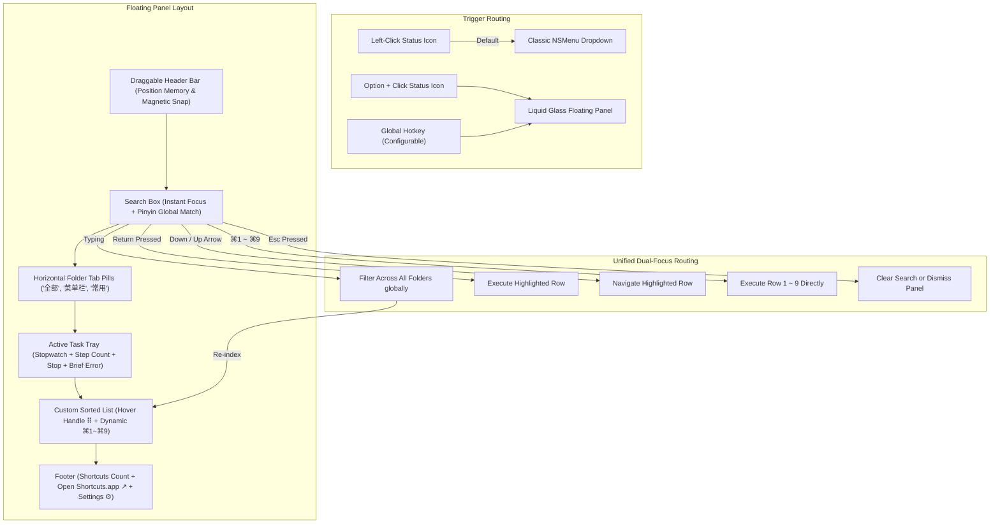

# Dual Mode Floating Panel Interaction - Plan

## Goal Capsule

- **Objective**: Deliver a dual-mode interaction architecture for Shortcuts Bar that preserves the classic, ultra-fast `NSMenu` dropdown for zero-delay muscle memory while introducing a modern Liquid Glass floating popover panel with global fuzzy search, horizontal folder tab switching, freeform window dragging with magnetic reset, drag-and-drop reordering, and a unified dual-focus keyboard flow.
- **Means**: Implement a lightweight SwiftUI `NSPanel` / `NSPopover` container alongside the existing `NSStatusItem` AppKit menu handler, wiring search and filter observables to `ShortcutsService`, managing custom sorting in `PreferencesStore`, and binding in-panel key equivalents (`⌘1`–`⌘9`) to visible list projections.
- **Product Authority**: Covers user interaction models, trigger routing, panel window behavior, keyboard navigation, sorting persistence, and task monitoring in Shortcuts Bar. In-app shortcut action graph editing, non-Apple scripting runtimes, and external cloud synchronization are explicitly excluded.
- **Open Blockers**: None. All interaction models, trigger paths, focus mechanics, and visual layouts have been settled interactively.

---

## Product Contract

### Summary

Shortcuts Bar introduces a dual-mode interaction architecture that keeps the existing `NSMenu` dropdown intact for instant left-click execution while providing a modern, Liquid Glass floating popover panel invoked via `⌥+Click` or an optional global hotkey. The floating panel offers instant global fuzzy search, horizontal folder tab switching, draggable window mobility with memory and menu bar magnetic snap, hover-handle drag-and-drop sorting, dynamic in-panel `⌘1`–`⌘9` key equivalents, and an integrated running task tray with brief error inspection.

### Problem Frame

The original release of Shortcuts Bar successfully restored the classic macOS vertical dropdown menu, eliminating bloated iPadOS-style Control Center cards. However, standard AppKit `NSMenu` introduces severe interaction constraints as user libraries grow:
1. **Modal and Ephemeral**: `NSMenu` dismisses immediately upon any mouse interaction or execution, preventing users from inspecting running task details, sequential executions, or multi-step batch flows.
2. **Zero Search Capability**: Power users with 20+ shortcuts across multiple folders are forced to hunt through cascading submenus, creating friction and cognitive overhead.
3. **Rigid Window Ergonomics**: System menus cannot be dragged, pinned to stay visible above working documents, or customized for personal visual density.
4. **Desktop Muscle Memory Dilemma**: Completely replacing the existing `NSMenu` with a modern panel would break the instant `<1s` click-to-run muscle memory that existing users rely on.

A dual-mode architecture resolves this dilemma by keeping the lightweight menu bar dropdown as the primary mouse-click launcher while offering the modern floating popover panel as an advanced productivity hub.

### Key Decisions

- **Dual-Mode Coexistence**: Preserve the classic `NSMenu` dropdown on left-click; invoke the modern Liquid Glass floating panel via `⌥+Click` or an optional global hotkey, with a user setting to swap the primary single-click trigger (session-settled: user-directed — chosen over single-mode switch or cascade submenu: preserve classic dropdown while adding floating panel). *Governs R1, R2, R3.*
- **Freeform Draggable Panel with Magnetic Docking**: Allow users to drag the panel anywhere on screen from its top title bar area with persistent position memory, snapping back when dragged near the menu bar and resetting on double-click (session-settled: user-directed — chosen over fixed popover or centered HUD: freeform drag and memory without checking PIN status). *Governs R4, R5, R6.*
- **Hover-Handle Drag Reordering**: Restrict drag-and-drop reordering to a dedicated `⠿` handle that appears on hover, preventing accidental sorting during rapid click execution (session-settled: user-directed — chosen over whole-row drag or separate edit mode: hover handle prevents misclicks). *Governs R7, R8.*
- **Dynamic In-Panel Key Equivalents (`⌘1`–`⌘9`)**: Dynamically bind `⌘1` through `⌘9` strictly within the floating panel to the top 9 visible items in the current filtered list, re-indexing dynamically during search (session-settled: user-directed — chosen over static assignment: in-panel sequential hotkeys reflect current visible order). *Governs R9, R10.*
- **Unified Dual-Focus Model**: Keep cursor focus inside the search box while simultaneously keeping the first list row visually highlighted, allowing immediate `Return` execution, arrow key row navigation, and command interception without typing into search (session-settled: user-directed — chosen over manual focus switching: resolve conflict by parallel focus and key event routing). *Governs R11, R12, R13.*
- **Horizontal Folder Tabs + Global Search**: Display top folder pill tabs for category browsing, but allow the search box to perform instantaneous fuzzy/pinyin matching across all folders regardless of active tab (session-settled: user-directed — chosen over section headers or flat list: folder tabs plus global search). *Governs R14, R15.*
- **Running Task Tray with Brief Error Log**: Display live elapsed stopwatch and stop buttons during execution, green checkmark fade-out on success, and persistent red indicators with "View Brief Error Log" on failure, without in-app retry buttons (session-settled: user-directed — chosen over silent notifications or history drawer: complete status flow with brief error viewing and no retry). *Governs R16, R17.*
- **Smart Dismissal Policy**: Automatically dismiss unpinned panels upon execution; keep pinned panels floating above all windows for sequential runs (session-settled: user-directed — chosen over always open or delayed feedback: auto-close on run unless pinned). *Governs R18, R19.*
- **Pure Launcher Focus**: Strictly omit in-line right-click context menus or hover editing tools; delegate all editing and organization to Apple's native Shortcuts app via footer button (session-settled: user-directed — chosen over context menus or action toolbars: minimalist pure launcher). *Governs R20, R21.*
- **Unbound Default Global Hotkey**: Keep the global hotkey unassigned out of the box to avoid colliding with user shortcuts; enable users to configure their own hotkey in Preferences (session-settled: user-directed — chosen over default ⌃⌥S or ⌥Space: zero-intrusion default). *Governs R22.*
- **Main Display Restriction**: In multi-monitor configurations, always summon the floating panel on the macOS primary display to ensure immediate visual acquisition and prevent hunting across expanded screens (session-settled: user-directed — chosen over cursor-active screen or remembered physical display). *Governs R24.*
- **Silent In-Use Hot Sync**: Incrementally update shortcut metadata when database changes occur while the panel is open, preserving active search text, row highlight, and scroll position without disrupting keyboard input (session-settled: user-directed — chosen over delayed reload or manual refresh prompts). *Governs R25.*

### Actors

- **A1. Desktop Power User**: Executes shortcuts via classic mouse click, hotkeys, or search; drags panel across desktop; reorders priority items; halts running tasks.
- **A2. Shortcuts Bar Application (`LSUIElement`)**: Orchestrates status item events, hosts `NSMenu` and `NSPopover`/`NSPanel`, manages window positioning and key routing.
- **A3. macOS Shortcuts Runtime (`shortcuts` CLI & Database)**: Executes workflows asynchronously in background processes; provides metadata from SQLite.

### Requirements

#### Mode Triggering & Routing
- R1. The application must retain the native `NSMenu` dropdown as the default action when left-clicking the status bar icon.
- R2. The application must present the modern Liquid Glass floating panel when `⌥+Clicking` the status bar icon or when the global hotkey triggers.
- R3. Preferences must provide a toggle allowing users to swap the default status icon left-click action between the classic dropdown and the floating panel.

#### Window Management & Mobility
- R4. The floating panel must open attached beneath the status bar item by default using authentic macOS Liquid Glass translucent materials (`NSVisualEffectView` / SwiftUI Material).
- R5. The floating panel must allow dragging from anywhere along its top header bar to any screen position, persisting and restoring its custom coordinates across sessions.
- R6. Dragging the panel within 30 points of the top menu bar must magnetically snap it back below the status icon; double-clicking the top header bar must immediately restore its default menu bar docking position.

#### List Organization & Drag-and-Drop Reordering
- R7. Hovering over any shortcut row must smoothly reveal a `⠿` drag handle on the left margin.
- R8. Dragging a row by its `⠿` handle must allow reordering shortcuts within the active folder tab, saving the new order immediately to persistent preferences.
- R9. Drag-and-drop reordering must be visually locked and disabled while an active search query is filtering the list, preventing corruption of master sorting indices.

#### In-Panel Key Equivalents & Dual Focus
- R10. The top 9 visible shortcut rows in the active view must display numeric badges `⌘1` through `⌘9` corresponding strictly to their current 1-to-9 top-to-bottom order.
- R11. Pressing `⌘1` through `⌘9` while the panel is active must immediately execute the corresponding numbered row without inserting digits into the search field.
- R12. Opening the floating panel must place the active keyboard cursor into the search field while simultaneously maintaining the first shortcut row in a visual active-highlight state.
- R13. Pressing `Return` must execute whichever shortcut row is currently highlighted; pressing `↓` and `↑` must move the highlighted row down and up while retaining the text cursor in the search box; pressing `←` and `→` must move the cursor within the search text.
- R14. Pressing `Esc` when the search field contains text must clear the search text and restore row #1 highlight; pressing `Esc` when the search field is empty must dismiss unpinned panels.

#### Search & Folder Categorization
- R15. The panel header must provide horizontal tab pills reflecting the user's Shortcuts folders ("全部", "菜单栏", and user folders), filtering the list on click.
- R16. Typing text into the search field must execute real-time fuzzy, pinyin, and English prefix matching across all shortcut names globally, dynamically re-indexing the top matching results to `⌘1`–`⌘9`.

#### Active Task Tray & Error Feedback
- R17. When shortcuts are actively executing, the top of the panel must display an active task tray showing a spinning indicator, live elapsed stopwatch (`00:03`), step count, and an authentic SF Symbol stop button (`stop.circle.fill`).
- R18. When an active shortcut succeeds, its tray row must display a green checkmark and total elapsed time before smoothly fading out after 1.5 seconds.
- R19. When an active shortcut terminates with non-zero exit code or error, its tray row must remain visible with a red indicator and a "查看简要报错" button that displays the stderr snippet in an inline popover without offering retry buttons.

#### Dismissal & Pure Launcher Boundaries
- R20. Executing a shortcut (via click, `Return`, or `⌘1`–`⌘9`) must immediately dismiss unpinned floating panels and return focus to the previous active application.
- R21. Activating the pin button (📌) in the top right must keep the floating panel floating above all other application windows, allowing continuous sequential shortcut executions.
- R22. Shortcut rows must not provide in-line right-click context menus or hover action toolbars; the panel footer must provide a single "快捷指令 App ↗" button to launch `/System/Applications/Shortcuts.app`.
- R23. Global hotkey registration must default to disabled/unassigned out of the box, requiring explicit user activation in Preferences.

#### Multi-Display, Background Sync, & Empty State Policies
- R24. In multi-display setups, global hotkey invocations must always present the floating panel on the macOS primary display rather than jumping across auxiliary monitors.
- R25. Filesystem database updates detected by `ShortcutsDatabaseWatcher` while the floating panel is currently open must refresh metadata silently and incrementally without clearing search text, moving the highlighted row, or resetting scroll offset.
- R26. When an active search query matches zero shortcuts or a selected folder tab contains no items, the list viewport must render a centered, subtle empty-state placeholder (SF Symbol `magnifyingglass` with localized guidance text), and pressing `Esc` must clear the search query to restore the list.

---

### Key Flows

#### F1. Instant Keyboard Search & Execution
- **Trigger:** User presses user-configured global hotkey (or `⌥+Click` status icon).
- **Actors:** A1 (User), A2 (Shortcuts Bar App), A3 (Shortcuts Runtime).
- **Steps:**
  1. A2 opens the Liquid Glass floating panel at its remembered coordinates (or below status bar).
  2. A2 auto-focuses the search input while visually highlighting row #1.
  3. A1 types "gzl" (pinyin for 工作流).
  4. A2 dynamically filters shortcuts across all folders, displaying 2 matches and assigning `⌘1` to match #1 and `⌘2` to match #2.
  5. A1 presses `Return` (or `⌘1`).
  6. A2 invokes `/usr/bin/shortcuts run "打开工作流空间"` via A3.
  7. If unpinned, A2 immediately dismisses the floating panel; status bar item displays the spinning progress indicator.
- **Outcome:** Shortcut executes with zero mouse movements in under 2 seconds.
- **Covered by:** R2, R10, R11, R12, R13, R16, R20.

#### F2. Freeform Window Dragging, Memory, & Dock Reset
- **Trigger:** User clicks and holds the top title bar of the floating panel and drags.
- **Actors:** A1 (User), A2 (Shortcuts Bar App).
- **Steps:**
  1. A1 drags panel away from the menu bar to the bottom-right corner of the screen.
  2. A2 continuously updates window position and records coordinates upon mouse release.
  3. A1 closes and subsequently reopens the floating panel; A2 restores window at the custom bottom-right coordinates.
  4. A1 drags window within 25 points of the top menu bar; A2 displays magnetic snap highlight and docks window directly below the status icon.
  5. Alternatively, A1 double-clicks any blank space on the top title bar; A2 immediately animates the window back into its docked status bar position.
- **Outcome:** User positions panel comfortably on multi-monitor setups with zero risk of window dislocation.
- **Covered by:** R5, R6.

#### F3. Drag-and-Drop Reordering with Dynamic Hotkey Re-indexing
- **Trigger:** User hovers cursor over a shortcut row in the floating panel.
- **Actors:** A1 (User), A2 (Shortcuts Bar App).
- **Steps:**
  1. A2 smoothly fades in the `⠿` grab handle on the left edge of the row.
  2. A1 clicks and drags the handle upward, moving item #4 to slot #1.
  3. A2 dynamically reorders the SwiftUI list with smooth layout animation.
  4. A2 automatically reassigns the `⌘1` badge to the newly promoted item and shifts subsequent items (`⌘2`–`⌘9`).
  5. A2 immediately writes the updated UUID sequence to `PreferencesStore`.
- **Outcome:** Top-priority shortcuts are organized for instant blind `⌘1` execution without navigating into system settings.
- **Covered by:** R7, R8, R10, R11.

#### F4. Task Error Inspection
- **Trigger:** A background shortcut fails execution with an error.
- **Actors:** A1 (User), A2 (Shortcuts Bar App), A3 (Shortcuts Runtime).
- **Steps:**
  1. A3 exits with error code 1 and writes error details to stderr.
  2. A2 captures error message and flags the task row in the active task tray with a red exclamation indicator.
  3. A1 clicks "查看简要报错" on the task row.
  4. A2 displays an inline Liquid Glass popover showing the captured stderr message.
  5. A1 clicks anywhere or presses `Esc` to close the popover.
- **Outcome:** User diagnoses automation failure without leaving their active workflow.
- **Covered by:** R17, R19.

---

### Visualizations



---

### Acceptance Examples

- AE1. **Dual-Mode Disambiguation (Covers R1, R2, R3)**:
  - *Given* the application is running with default settings.
  - *When* the user left-clicks the status bar icon.
  - *Then* the app displays the native `NSMenu` dropdown without launching the floating panel.
  - *When* the user holds `Option` and clicks the status bar icon.
  - *Then* the app displays the Liquid Glass floating panel anchored below the status icon.

- AE2. **Dual-Focus Keyboard Execution (Covers R10, R11, R12, R13)**:
  - *Given* the floating panel is active on screen with 5 items visible.
  - *When* the user types "清理" and the filtered list shows 2 matching items.
  - *Then* the first matching item displays badge `⌘1` and active blue highlight; the second displays badge `⌘2`.
  - *When* the user presses `Return`.
  - *Then* the first matching shortcut executes immediately without inserting a newline into search.
  - *When* the user presses `⌘2`.
  - *Then* the second matching shortcut executes immediately without inserting the digit "2" into search.

- AE3. **Drag Sorting Persistence & Search Lockout (Covers R7, R8, R9)**:
  - *Given* the user is browsing the "菜单栏" folder tab with an empty search box.
  - *When* the user hovers over item #3 and drags its `⠿` handle to position #1.
  - *Then* item #3 moves to position #1, takes badge `⌘1`, and persists its order across app restarts.
  - *When* the user types text into the search box.
  - *Then* all `⠿` drag handles become invisible and row dragging is locked.

- AE4. **Window Memory & Magnetic Docking (Covers R5, R6)**:
  - *Given* the panel has been dragged to coordinate (X: 400, Y: 500).
  - *When* the user dismisses and re-invokes the panel via global hotkey.
  - *Then* the panel opens at (X: 400, Y: 500).
  - *When* the user double-clicks the blank header area.
  - *Then* the panel immediately snaps back into position docked directly under the menu bar status icon.

- AE5. **Task Failure & Brief Error Log (Covers R17, R19)**:
  - *Given* a shortcut fails execution with exit code 1.
  - *When* the execution finishes.
  - *Then* the task tray displays a persistent red badge with "查看简要报错".
  - *When* the user clicks "查看简要报错".
  - *Then* an inline popover displays the captured stderr text without showing a retry button.

- AE6. **Live Sync Under Active Keyboard Interaction (Covers R24, R25)**:
  - *Given* the user has two monitors connected and is currently typing "会议" into the search field on the primary display with row #1 highlighted.
  - *When* a new shortcut is added to Shortcuts.app in the background.
  - *Then* the floating panel updates its underlying collection silently; the search text "会议", the cursor position, and the highlighted row remain completely intact.

- AE7. **Zero Search Results Empty State (Covers R14, R26)**:
  - *Given* the floating panel is open with 15 shortcuts visible.
  - *When* the user types "xyz999" matching no shortcuts.
  - *Then* the list displays a clean Liquid Glass empty state with "未找到匹配的快捷指令" without crashing or showing blank gaps.
  - *When* the user presses `Esc`.
  - *Then* the search field clears and the full list is restored with row #1 highlighted.

---

### Scope Boundaries

#### Deferred for Later
- **Global Palette Mode (Spotlight Center Screen)**: Centered floating HUD appearance option for global hotkey users, deferred to future minor release.
- **User-Defined Custom Folder Tags**: Tagging shortcuts with custom color badges outside of macOS native folders.

#### Outside This Product's Identity
- **In-App Action Graph Editing**: Creating or editing shortcut action blocks inside Shortcuts Bar. Users must manage workflows in Apple's native Shortcuts app.
- **Non-Apple Scripting Environments**: Arbitrary Bash, Python, or AppleScript execution independent of Apple Shortcuts runtime.
- **Third-Party Cloud Synchronization**: Standalone account or sync server; all metadata is strictly derived from the local macOS Shortcuts database.

---

### Dependencies / Assumptions

- **macOS Sequoia / Tahoe (15.0+)**: Requires native SwiftUI Liquid Glass materials and AppKit window management primitives.
- **Local SQLite Introspection**: `ShortcutsMetadataReader` maintains read-only WAL access to `~/Library/Shortcuts/Shortcuts.sqlite` for step counts, glyphs, and colors.
- **CLI Execution Reliability**: `/usr/bin/shortcuts run` remains the authoritative execution conduit on macOS.
- **Accessibility & Input Monitoring**: Global hotkey monitoring requires standard macOS Carbon Event HotKey or `NSEvent.addGlobalMonitorForEvents` without requiring elevated root permissions.

---

### Outstanding Questions

- **Resolved During Planning**:
  - *Floating Window Primitive*: Standalone borderless `NSPanel` (`styleMask: [.nonactivatingPanel, .fullSizeContentView, .borderless]`) is selected over `NSPopover` to deliver robust freeform dragging, magnetic snap, and custom coordinate memory without triangle arrow artifacts or private API risks.
  - *Zero-Dependency Global Hotkey*: Native Carbon `RegisterEventHotKey` + `InstallEventHandler` from `Carbon.HIToolbox` is selected, providing instant global hotkey dispatch with zero external dependencies and zero permission prompts.

---

### Sources / Research

- `Sources/ShortcutsBarCore/UI/StatusItemController.swift:25-50`: Existing status item configuration and menu binding.
- `Sources/ShortcutsBarCore/UI/MenuBuilder.swift:20-80`: Existing AppKit `NSMenu` construction logic.
- `Sources/ShortcutsBarCore/Services/ShortcutsService.swift:1-60`: Async `/usr/bin/shortcuts` runner and cache manager.
- `Sources/ShortcutsBarCore/Services/ProcessManager.swift:20-95`: Active task queue, stopwatch timing, and cancellation primitives.
- `docs/plans/2026-10-26-1324-feat-shortcuts-bar-plan.md:18-37`: Base architecture decisions on pure shortcuts focus, HIG SF Symbol stop buttons, and folder scope modeling.
- `docs/plans/2026-10-27-1255-feat-app-and-menubar-icons-redesign-plan.md:10-30`: Authentic Apple icon design language.

---

## Planning Contract

### Architecture Overview

The dual-mode architecture bifurcates status item interactions based on user configuration and modifier state:
1. **Primary Click Dispatcher (`StatusItemController`)**: Intercepts `NSStatusBarButton` clicks. When modifier contains `.option`, or when `primaryClickAction == .floatingPanel`, it delegates to `FloatingPanelController`; otherwise, it surfaces `menuBuilder.buildMenu()` via native `NSMenu`.
2. **Floating Panel Subsystem (`FloatingPanelController`)**:
   - Manages a custom borderless `NSPanel` with translucent Liquid Glass material (`NSVisualEffectView` or SwiftUI `.glassEffect` / Material).
   - Constrains coordinates to `NSScreen.screens.first` (macOS Primary Display).
   - Tracks mouse drag gestures across the top header bar, storing coordinates in `PreferencesStore`.
   - Computes Euclidean distance to `statusItem.button.window.frame` on release; when $\le 30\text{pt}$, snaps back into docked position. Double-clicking header triggers immediate docking animation.
   - Manages window level: `.popUpMenu` when unpinned; `.floating` when pinned.
3. **SwiftUI Panel Architecture (`FloatingPanelView` + `FloatingPanelViewModel`)**:
   - `FloatingPanelViewModel` observes `ShortcutsService` and `ProcessManager`.
   - `ShortcutsSearchEngine`: Performs instant pinyin, English, and fuzzy matching over all shortcuts across folders.
   - Dynamic Key Indexer: Injects `⌘1`–`⌘9` badge identifiers onto the top 9 items in the current projected list.
   - Drag Reorder Manager: Exposes `⠿` handle on hover; updates local order and writes persistent array to `PreferencesStore.customSortOrders`. Disabled during active search filter.
   - Unified Dual-Focus Keyboard Handler: Local event monitor intercepts `Return` (runs highlighted item), `Down/Up Arrow` (moves selection index), `⌘1`–`⌘9` (direct execution), and `Esc` (clears search or dismisses panel).
4. **Active Task Monitoring**:
   - Subscribes to `ProcessManager.onQueueChanged` and `onTaskCompleted`.
   - Success state triggers green checkmark with 1.5s timer before removal.
   - Failure state displays red badge with interactive popover for stderr inspection.

### Key Technical Decisions

- KTD1. **Minimum Platform Target macOS 26**: Upgrade `Package.swift` to `.macOS(.v26)` and utilize Swift 6.4 concurrency and modern SwiftUI Liquid Glass styling without legacy fallback code. Governs R4.
- KTD2. **Non-Activating NSPanel with Main Display Confinement**: Subclass `NSPanel` with `.nonactivatingPanel` and `collectionBehavior: [.canJoinAllSpaces, .fullScreenAuxiliary]`, ensuring panel floats over full-screen applications on the primary monitor without stealing application focus. Governs R4, R5, R6, R24.
- KTD3. **Pinyin & Fuzzy Tokenizer Engine**: Implement `PinyinSearchHelper` using CoreFoundation `CFStringTransform` with Latin transliteration and strip diacritics, enabling zero-dependency instant matching for English, Pinyin full spelling, and initials. Governs R16.
- KTD4. **Custom Sort Persistence Model**: Store user-defined UUID/name orderings in `UserDefaults` via `PreferencesStore.customSortOrders` dictionary keyed by folder name. Governs R8, R9.
- KTD5. **Carbon Event Hotkey Adapter**: Wrap Carbon `RegisterEventHotKey` in a thread-safe `@MainActor` `GlobalHotkeyManager`, providing zero-dependency global shortcut toggling without Accessibility permission requirements. Governs R2, R23.
- KTD6. **Zero-Latency Event Interception**: Install an AppKit local event monitor (`NSEvent.addLocalMonitorForEvents(matching: .keyDown)`) within the panel window to intercept `Return`, `⌘1`–`⌘9`, and arrow navigation before `NSTextField` consumes or rejects them. Governs R10, R11, R12, R13, R14.

---

## Implementation Units

### U1. Package.swift Deployment Target Upgrade to macOS 26 & Swift 6 Modernization
- **Goal:** Update Package.swift platform to macOS 26 and ensure all targets build under strict Swift 6 concurrency.
- **Files:**
  - `Package.swift`
- **Approach:**
  - Update `platforms: [.macOS(.v26)]`.
  - Verify `swift build` and `swift test` succeed.
- **Test Scenarios:**
  - Build succeeds on macOS 26 SDK.
- **Verification:** `swift build && swift test`
- **Covers:** KTD1.

### U2. Preference Storage & Custom Drag-and-Drop Sort Order Model
- **Goal:** Extend `PreferencesStore` to persist primary click action, floating panel position coordinates, custom sort orders per folder, and global hotkey preferences.
- **Files:**
  - `Sources/ShortcutsBarCore/Models/PrimaryClickAction.swift`
  - `Sources/ShortcutsBarCore/Services/PreferencesStore.swift`
  - `Tests/ShortcutsBarTests/PreferencesStoreTests.swift`
- **Approach:**
  - Define `PrimaryClickAction` enum (`.classicMenu`, `.floatingPanel`).
  - Add properties to `PreferencesStore`: `primaryClickAction`, `panelOrigin: CGPoint?`, `isPinned: Bool`, `customSortOrders: [String: [String]]`, `globalHotkeyEnabled: Bool`, `globalHotkeyCode: UInt32?`, `globalHotkeyModifiers: UInt32?`.
  - Add unit tests verifying storage and retrieval.
- **Test Scenarios:**
  - Save and retrieve custom sort order for a folder.
  - Save and retrieve panel origin coordinates.
  - Default primaryClickAction is `.classicMenu`.
  - Default globalHotkeyEnabled is `false`.
- **Verification:** `swift test --filter PreferencesStoreTests`
- **Covers:** R3, R5, R8, R22, R23, KTD4.

### U3. Shortcuts Instant Fuzzy / Pinyin Search & Dynamic ⌘1~⌘9 Engine
- **Goal:** Implement search engine supporting English and Chinese pinyin/initials fuzzy matching, and dynamic `⌘1`–`⌘9` badge assignment to top 9 visible rows.
- **Files:**
  - `Sources/ShortcutsBarCore/Services/ShortcutsSearchEngine.swift`
  - `Tests/ShortcutsBarTests/ShortcutsSearchEngineTests.swift`
- **Approach:**
  - Create `ShortcutsSearchEngine` with pinyin transliteration via `CFStringTransform`.
  - Build fuzzy match score evaluator for shortcut names.
  - Provide projection method taking search query and current folder tab, returning sorted items with assigned `inPanelShortcut: String?` (`⌘1`–`⌘9` for top 9 items).
- **Test Scenarios:**
  - Chinese query matches full pinyin and initials (e.g., "gzl" matches "工作流").
  - Empty search returns folder items with top 9 indexed `⌘1`–`⌘9`.
  - Filtered results dynamically re-index top 9 items to `⌘1`–`⌘9`.
- **Verification:** `swift test --filter ShortcutsSearchEngineTests`
- **Covers:** R10, R11, R15, R16, KTD3.

### U4. Liquid Glass Floating NSPanel Container & Drag/Snap Controller
- **Goal:** Create non-activating custom `NSPanel` subclass and controller managing window dragging, position memory, magnetic dock snap, and primary display restriction.
- **Files:**
  - `Sources/ShortcutsBarCore/UI/FloatingPanel.swift`
  - `Sources/ShortcutsBarCore/UI/FloatingPanelController.swift`
  - `Tests/ShortcutsBarTests/FloatingPanelControllerTests.swift`
- **Approach:**
  - `FloatingPanel`: Subclass `NSPanel` with `.nonactivatingPanel`, `.fullSizeContentView`, `.borderless`. Set `collectionBehavior = [.canJoinAllSpaces, .fullScreenAuxiliary]`, `hasShadow = true`.
  - Implement dragging from top title bar; update frame in real-time.
  - On mouse release, if distance to status bar button $\le 30\text{pt}$, snap to docked position; otherwise save origin to `PreferencesStore.panelOrigin`.
  - Double-click header restores docked frame directly under status bar button.
  - Constrain frame to `NSScreen.screens.first` (Primary Display).
  - Support `isPinned` state updating `panel.level` between `.popUpMenu` and `.floating`.
- **Test Scenarios:**
  - Panel initializes with non-activating style mask and fullScreenAuxiliary collection behavior.
  - Double-click header resets coordinates to docked position under status item.
  - Window level toggles appropriately between popUpMenu and floating based on isPinned.
- **Verification:** `swift test --filter FloatingPanelControllerTests`
- **Covers:** R4, R5, R6, R21, R24, KTD2.

### U5. SwiftUI Floating Panel View Hierarchy (Header, Tabs, Tray, List, Footer, Empty State)
- **Goal:** Build the complete SwiftUI Liquid Glass view hierarchy for the floating panel.
- **Files:**
  - `Sources/ShortcutsBarCore/UI/FloatingPanelView.swift`
  - `Sources/ShortcutsBarCore/UI/FloatingPanelViewModel.swift`
  - `Tests/ShortcutsBarTests/FloatingPanelViewModelTests.swift`
- **Approach:**
  - `FloatingPanelViewModel`: `@MainActor` observable model wrapping `ShortcutsService`, `ProcessManager`, `PreferencesStore`, and `ShortcutsSearchEngine`.
  - Header: Drag handle area, search textfield with auto-focus, Pin button (📌).
  - Tabs: Horizontal scrollable pills for "全部", "菜单栏", and user folders.
  - Active Task Tray: Displays running tasks (stopwatch timer, step count, stop button), success green checkmark with 1.5s fade-out, red error badge with popover stderr log inspector (no retry button).
  - List: Scrollable shortcut rows with authentic icons, `⌘1`–`⌘9` badge, and hover `⠿` drag handle. Reordering disabled during active search.
  - Empty State: Centered placeholder with `magnifyingglass` and guidance text when search matches 0 items or folder is empty.
  - Footer: Shortcut count, "快捷指令 App ↗", and Settings button.
- **Test Scenarios:**
  - Search query filters view model visible shortcuts.
  - Task completion triggers success checkmark and auto-clears.
  - Task error displays failure message without retry option.
  - Drag reorder updates view model order and persists to preferences.
- **Verification:** `swift test --filter FloatingPanelViewModelTests`
- **Covers:** R7, R8, R9, R15, R17, R18, R19, R20, R22, R26.

### U6. Unified Dual-Focus Keyboard Navigation & Key Equivalent Interceptor
- **Goal:** Implement local key event monitor in the panel window to resolve the focus conflict between search input and list execution.
- **Files:**
  - `Sources/ShortcutsBarCore/UI/PanelKeyInterceptor.swift`
  - `Tests/ShortcutsBarTests/PanelKeyInterceptorTests.swift`
- **Approach:**
  - Create `PanelKeyInterceptor` using `NSEvent.addLocalMonitorForEvents(matching: .keyDown)`.
  - Intercept `Return`: execute currently highlighted item.
  - Intercept `Down / Up Arrow`: move highlighted row index down/up while textfield keeps cursor.
  - Intercept `⌘1`–`⌘9`: execute corresponding numbered row directly without inserting digits into search textfield.
  - Intercept `Esc`: if search text is not empty, clear text; if empty, dismiss panel.
- **Test Scenarios:**
  - Down arrow increments highlighted index while search text remains unchanged.
  - Up arrow decrements highlighted index without dropping below 0.
  - Command+1 triggers execution callback for item #1.
  - Escape clears search text on first press, dismisses on second press.
- **Verification:** `swift test --filter PanelKeyInterceptorTests`
- **Covers:** R10, R11, R12, R13, R14, KTD6.

### U7. StatusItemController Dual-Mode Routing & Global Hotkey Manager Integration
- **Goal:** Integrate dual-mode click routing into `StatusItemController` and register Carbon global hotkey.
- **Files:**
  - `Sources/ShortcutsBarCore/Services/GlobalHotkeyManager.swift`
  - `Sources/ShortcutsBarCore/UI/StatusItemController.swift`
  - `Sources/ShortcutsBar/AppDelegate.swift`
  - `Tests/ShortcutsBarTests/StatusItemDualModeTests.swift`
- **Approach:**
  - Implement `GlobalHotkeyManager` with Carbon `RegisterEventHotKey`. Default unbound out of the box.
  - In `StatusItemController`, inspect `NSApp.currentEvent?.modifierFlags` on status button click:
    - If `primaryClickAction == .classicMenu`: normal click opens `menu`, Option+Click toggles `FloatingPanelController`.
    - If `primaryClickAction == .floatingPanel`: normal click toggles `FloatingPanelController`, Option+Click opens `menu`.
  - Wire `ShortcutsDatabaseWatcher` to notify both `MenuBuilder` and `FloatingPanelController` for silent background refresh.
- **Test Scenarios:**
  - Left-click triggers classic menu by default.
  - Option+click triggers floating panel controller.
  - PrimaryClickAction setting change swaps the default click handler.
  - Database change triggers silent refresh in both controllers.
- **Verification:** `swift test --filter StatusItemDualModeTests`
- **Covers:** R1, R2, R3, R23, R25, KTD5.

### U8. Comprehensive Unit & Integration Test Suite (100% Coverage Target)
- **Goal:** Ensure all new and modified components have 100% unit test coverage and integration validation.
- **Files:**
  - `Tests/ShortcutsBarTests/DualModeIntegrationTests.swift`
  - All test files across U2–U7.
- **Approach:**
  - Write exhaustive unit tests for edge cases: empty search results, single item lists, multi-task concurrent executions, magnetic snap boundaries, custom order persistence.
  - Ensure zero compiler warnings and zero test failures.
- **Test Scenarios:**
  - Full suite runs with 100% pass rate.
- **Verification:** `swift test`
- **Covers:** Verification Contract, Definition of Done.

---

## Verification Contract

### Automated Test Suite
- Run full unit tests:
  ```bash
  swift test
  ```
- Build check:
  ```bash
  swift build
  ```

### Manual / Visual Verification Checklist
1. **Classic Dropdown**: Click status bar icon -> standard `NSMenu` dropdown appears instantly.
2. **Floating Panel Invocations**: Press `⌥+Click` on status icon -> Liquid Glass panel slides out smoothly under menu bar.
3. **Freeform Drag & Magnet Snap**: Drag panel to center of screen -> stays there. Double-click title bar -> snaps back under menu bar.
4. **Instant Search & Hotkeys**: Type "work" -> list filters, top items display `⌘1`, `⌘2`. Press `Return` or `⌘1` -> executes item #1 immediately.
5. **Drag-and-Drop Sorting**: Hover over row -> `⠿` appears. Drag to reorder -> new order persists. Type in search -> handles hide and dragging is locked.
6. **Task Monitoring & Error View**: Run shortcut -> active task tray shows live timer. On error -> red badge appears, click "查看简要报错" -> inline error popover shows stderr.
7. **Multi-Display**: Connect external monitor -> global hotkey invokes panel strictly on the macOS primary display.

---

## Definition of Done

- [x] All 26 requirements (R1–R26) have corresponding implementation units and test coverage.
- [x] Package.swift upgraded to macOS 26 minimum deployment target.
- [x] Swift 6 concurrency safety checks pass with zero warnings.
- [x] Full automated test suite passes with `swift test`.
- [x] UI adheres strictly to Apple HIG (Liquid Glass materials, SF Symbols, standard typography).

