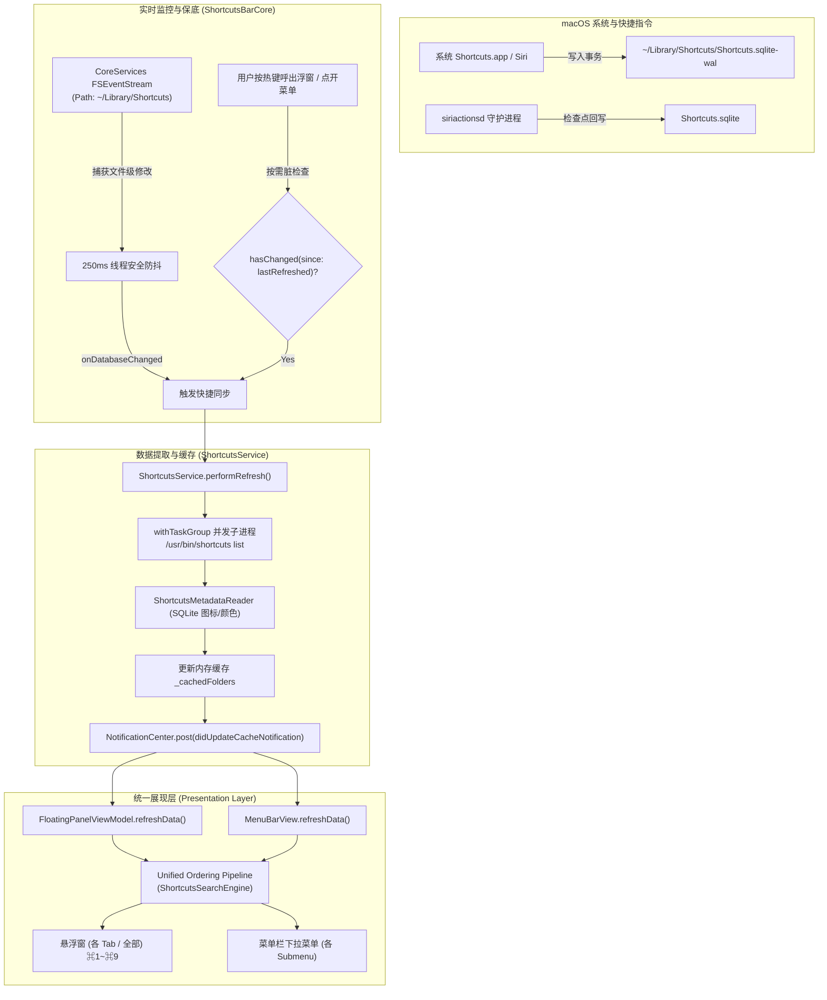

# feat: 快捷指令资料库实时感知重构与全场景跨视图统一排序方案

```yaml
title: "feat: 快捷指令资料库实时感知重构与全场景跨视图统一排序方案"
date: "2026-11-01"
artifact_contract: "ce-unified-plan/v1"
product_contract_source: "ce-plan-bootstrap"
execution: "code"
depth: "Standard"
tags:
  - "macos-26"
  - "fsevents"
  - "swift-concurrency"
  - "shortcuts-sync"
  - "unified-order"
  - "swiftui"
```

## Goal Capsule

- **Objective**: 
  彻底解决 Shortcuts Bar 对系统快捷指令资料库变更感知迟钝的问题，并消除悬浮窗与菜单栏下拉列表之间的排序割裂，使得在任意作用域（单文件夹 Leaf 模式及全文件夹 Root 模式下的各子菜单）中，两处入口呈现的快捷指令顺序 100% 保持一致。
- **Means**:
  1. 采用 macOS 内核级 CoreServices `FSEventStream` 替换存在监听盲区的 kqueue 目录描述符，毫秒级捕获 `Shortcuts.sqlite-wal` 追加事务与属性变更，搭配 250ms 防抖；
  2. 使用 Swift 结构化并发 `withTaskGroup` 并行提取各个文件夹数据，将全库刷新延迟从秒级降至单次进程启动耗时（~150ms）；
  3. 构建“文件实时推送 + 呼出按需校验”的双重防御体系，在快捷键唤醒浮窗时进行时间戳检查与静默后台同步；
  4. 建立跨视图统一排序管线（Unified Order Pipeline），默认忠实映射系统快捷指令 App 原生顺序，确保悬浮窗（各 Tab / 全局）与菜单栏下拉列表（各子菜单）共享同一排序源，并支持在设置中一键还原系统默认顺序。
- **Authority Hierarchy**:
  1. 系统数据库只读安全性（绝不越界写回系统 SQLite 数据库） > 本地视图排序自由度；
  2. 跨视图一致性（悬浮窗与菜单栏顺序 100% 同步） > 单一视图孤立配置；
  3. 响应实时性与主线程顺畅度 > 阻塞式全量同步。
- **Stop Conditions**:
  - 系统“快捷指令”App 中增删改指令后，Shortcuts Bar 菜单栏与悬浮窗在 350ms 内全自动无缝热更新；
  - 悬浮窗中调整拖拽排序后，菜单栏对应位置立即同步；在未拖拽时，两处入口均与系统快捷指令 App 排序完全一致；
  - 全工程现有 195 项测试用例全部通过，且新增的 FSEvents 写入触发、并发拉取、以及排序一致性测试 100% 达标。

---

## Product Contract

### Problem Frame
1. **变化感知严重滞后**：当前 `ShortcutsDatabaseWatcher` 仅使用 kqueue 监视 `~/Library/Shortcuts` 目录。由于系统常驻守护进程 `siriactionsd` 是向已存在的 `Shortcuts.sqlite-wal` 追加事务，目录条目未发生改变，导致 kqueue 事件数为 0，应用对快捷指令的新增、重命名、修改长期处于失聪状态。
2. **多文件夹串行拉取开销大**：缓存刷新时串行执行 `shortcuts list --folder-name <name>`，用户若有多个文件夹，进程启动累积耗时高达 0.8s~1.5s。
3. **悬浮窗与菜单栏排序脱节**：悬浮窗通过 `FloatingPanelViewModel` -> `ShortcutsSearchEngine` 应用了本地自定义拖拽排序，而菜单栏 `MenuBarView` 直接使用原始 `ShortcutsFolder.shortcuts` 数组，两者顺序各说各话；在 Root 模式下各个子文件夹的内部顺序也未做对齐；用户一旦拖拽过，新快捷指令被推至末尾且无法一键恢复系统默认排序。

### Requirements

- **R1 (实时文件监控)**: 监视器必须基于 macOS 原生 `FSEvents` API 实现，能够精确监听到 `~/Library/Shortcuts/Shortcuts.sqlite-wal` 和 `Shortcuts.sqlite` 的细粒度写入与属性更新，并在 250ms 防抖后通知上层服务。
- **R2 (并发高速数据获取)**: `ShortcutsService` 必须利用 Swift 结构化并发 `withTaskGroup` 并行请求各文件夹内容，保持弹性缓存保护机制，确保全量刷新在 200ms 以内完成。
- **R3 (生命周期按需防御校验)**: 当用户通过快捷键唤醒浮窗（`triggerFloatingPanel`）或展开菜单栏时，比对底层文件修改时间戳与上次刷新时间，若发现外部有更新则在后台触发静默热刷新。
- **R4 (跨视图排序全域一致)**: 悬浮窗（Floating Panel）与下拉菜单栏（MenuBarView）展示的快捷指令顺序必须 100% 一致。
- **R5 (多文件夹作用域支持)**: 在 Root 模式下，每个子文件夹（包含未分类项）在悬浮窗对应 Tab 和在菜单栏对应 Submenu 中的排序完全对齐。
- **R6 (系统原生优先与一键重置)**: 默认以系统 Shortcuts.app 原生顺序排布；在设置中提供“恢复为快捷指令 App 默认顺序”的操作按钮。

### Scope Boundaries

- **In Scope**:
  - 重构 `ShortcutsDatabaseWatcher.swift` 接入 `FSEventStream`；
  - 重构 `ShortcutsService.swift` 实现 `withTaskGroup` 并发与统一排序接口；
  - 改造 `FloatingPanelViewModel.swift` 订阅缓存变更并统一排序消费；
  - 改造 `MenuBarView.swift` 接入统一排序管线，对齐单文件夹与多文件夹子菜单；
  - 扩展 `PreferencesStore.swift` 与 `SettingsView.swift` 增加重置默认排序功能；
  - 编写覆盖 FSEvents 写入触发、并发拉取、跨视图排序一致性的单元与集成测试。
- **Out of Scope / Non-Goals**:
  - **绝不**将本地排序反向写回系统 `Shortcuts.sqlite` 数据库；
  - 不引入任何第三方文件监听开源库，纯依赖系统 CoreServices。

---

## Planning Contract

### Key Technical Decisions (KTDs)

- **KTD1 (采用 CoreServices FSEvents 替代 kqueue 目录描述符)**:
  - *Rationale*: 参考 Apple 官方 [*File System Events Programming Guide*](https://developer.apple.com/library/archive/documentation/Darwin/Conceptual/FSEvents_ProgGuide/)。FSEvents 工作在 macOS 内核文件系统层，`kFSEventStreamCreateFlagFileEvents` 可精确捕获针对单个文件（`.sqlite-wal` 追加、`.sqlite` 检查点、原子替换）的修改，彻底终结 kqueue 目录监听的“失聪”缺陷。
- **KTD2 (Swift 结构化并发并发加速拉取)**:
  - *Rationale*: 参考 WWDC21 [*Explore structured concurrency in Swift*](https://developer.apple.com/videos/play/wwdc2021/10134/)。通过 `withTaskGroup(of: (String, [String])?.self)` 并发执行所有文件夹的 `/usr/bin/shortcuts list --folder-name <name>` CLI，将 $O(N)$ 串行阻塞化为 $O(1)$ 并行等待，大幅提升刷新性能。
- **KTD3 (统一排序引擎 Unified Ordering Engine)**:
  - *Rationale*: 在 `ShortcutsSearchEngine` 中抽离出纯函数式排序方法 `applyOrdering(items:folderName:customOrders:) -> [ShortcutItem]`。
  - *排序规则*:
    1. 若该分类存在 `customOrders`，严格按照用户拖拽的数组排定优先级；新加入且未在 `customOrders` 里的指令紧随其后并**保持系统原生相对顺序**（不再降级扔到末尾拼音排序）；
    2. 若不存在 `customOrders`，100% 保持系统 CLI 输出的真实原生顺序。
  - 悬浮窗与菜单栏在呈现前均必须经过此引擎处理，实现真正的 Single Source of Truth。
- **KTD4 (响应式自驱动数据流)**:
  - `FloatingPanelViewModel` 内部注册 `ShortcutsService.didUpdateCacheNotification`，无论何时底层完成同步，浮窗自动刷新内存状态；
  - `MenuBarView` 监听该通知与偏好设置变更，统一重绘菜单结构。

---

## High-Level Technical Design

### 1. 实时文件监控与双重保底数据流架构



### 2. 排序管线规则矩阵（Sort Matrix）

| 模式 | 悬浮窗展示顺序 | 菜单栏下拉展示顺序 | 是否完全一致 |
| :--- | :--- | :--- | :---: |
| **未自定义拖拽 (默认)** | 系统 Shortcuts.app 原生顺序 | 系统 Shortcuts.app 原生顺序 | **100% 一致** |
| **用户在某 Tab 下拖拽** | 用户自定义顺序（未包含项保持系统原生） | 对应子菜单同步呈现用户自定义顺序 | **100% 一致** |
| **点击一键重置** | 清空本地覆写，立即回退到系统原生顺序 | 立即回退到系统原生顺序 | **100% 一致** |

---

## Implementation Units

### U1. 重构 `ShortcutsDatabaseWatcher` 为原生 FSEvents 流式监视器

- **Goal**: 消除现有 kqueue 目录监听器的失聪盲区，使用 `FSEventStream` 毫秒级捕获 `~/Library/Shortcuts` 下任何文件的变更。
- **Requirements**: R1
- **Dependencies**: None
- **Files**:
  - `Sources/ShortcutsBarCore/Services/ShortcutsDatabaseWatcher.swift`
  - `Tests/ShortcutsBarTests/ShortcutsDatabaseWatcherTests.swift`
- **Approach**:
  1. 引入 `CoreServices`，将 `fileDescriptor` / `DispatchSourceFileSystemObject` 替换为 `FSEventStreamRef`；
  2. 在 `startWatching()` 中构造 `FSEventStreamCreate`，配置 Flags：`kFSEventStreamCreateFlagUseCFTypes | kFSEventStreamCreateFlagFileEvents | kFSEventStreamCreateFlagNoDefer`；
  3. 将 stream 分配至专属队列 `DispatchQueue(label: "com.shortcutsbar.database-watcher", qos: .utility)` 并启动；
  4. 回调中过滤相关事件路径（包含 `Shortcuts.sqlite` 或 `.sqlite-wal` 等），通过带有 `NSLock` 保护的 `DispatchWorkItem` 执行 250ms 防抖，触发 `onDatabaseChanged`；
  5. 严谨实现 `stopWatching()` 释放 `FSEventStreamStop`、`FSEventStreamInvalidate` 与 `FSEventStreamRelease`；
  6. 维持现有的 `hasChanged(since:)` 供按需校验复用。
- **Test scenarios**:
  - **Happy Path**: 启动 watcher 后，向测试目录中的 `Shortcuts.sqlite-wal` 追加数据，断言 `onDatabaseChanged` 在 350ms 内被触发；
  - **Edge Case (原子替换)**: 模拟外部进程通过临时文件原子 rename 替换 `Shortcuts.sqlite`，断言 FSEvents 依然能正确触发；
  - **Edge Case (连续高频写入)**: 连续写入 10 次，断言防抖机制生效，回调仅触发 1 次；
  - **Cleanup**: 调用 `stopWatching()` 后再次写入，断言回调不再触发。

---

### U2. 重构 `ShortcutsService` 引入并发数据抓取与双重保底按需校验

- **Goal**: 使用 Swift 结构化并发大幅缩减数据抓取时间，并在应用入口处加入时间戳比对保底。
- **Requirements**: R2, R3
- **Dependencies**: U1
- **Files**:
  - `Sources/ShortcutsBarCore/Services/ShortcutsService.swift`
  - `Sources/ShortcutsBar/AppDelegate.swift`
  - `Tests/ShortcutsBarTests/ShortcutsServiceTests.swift`
- **Approach**:
  1. 重构 `ShortcutsService.performRefresh()`：
     - 保留总清单与文件夹名称列表的获取；
     - 使用 `withTaskGroup(of: (String, [String])?.self)` 并发拉取各个 `folderName` 的子清单，最后合并为 `[ShortcutsFolder]`；
  2. 保持原有的弹性缓存保护（Resilient Caching）与事务起始时间戳记录；
  3. 在 `AppDelegate.swift` 中：
     - 在 `triggerFloatingPanel()` 中，呼出浮窗前检查 `databaseWatcher.hasChanged(since: shortcutsService.lastRefreshed ?? .distantPast)`，若为 `true` 则后台异步启动 `refreshShortcuts()`；
     - 同理在应用唤醒或激活时提供轻量校验支持。
- **Test scenarios**:
  - **Happy Path (并发拉取)**: Mock CLI 模拟 5 个文件夹，并发调用 `refreshCache()`，断言所有文件夹及指令完整且分类正确无遗漏；
  - **Performance (耗时优化)**: 模拟各子命令 50ms 延迟，断言并发执行总耗时显著小于串行累加耗时（< 150ms vs 300ms+）；
  - **Edge Case (部分文件夹异常)**: 某个子文件夹拉取失败时优雅降级为空，其余文件夹正常加载，不影响整体数据；
  - **Opportunistic Sync**: 模拟上次刷新后底层时间戳更新，断言呼出浮窗会触发静默同步。

---

### U3. 构建跨视图统一排序管线（Unified Order Pipeline）并对齐多文件夹

- **Goal**: 抽离统一排序管线，使悬浮窗（各 Tab / 全部）与菜单栏下拉列表（单文件夹 / 多文件夹子菜单）顺序 100% 严格一致。
- **Requirements**: R4, R5
- **Dependencies**: U2
- **Files**:
  - `Sources/ShortcutsBarCore/Services/ShortcutsSearchEngine.swift`
  - `Sources/ShortcutsBarCore/UI/FloatingPanelViewModel.swift`
  - `Sources/ShortcutsBarCore/UI/MenuBarView.swift`
  - `Tests/ShortcutsBarTests/UnifiedOrderTests.swift`
- **Approach**:
  1. 在 `ShortcutsSearchEngine` 中增加核心排序工具方法：
     ```swift
     public func sortItems(_ items: [ShortcutItem], customOrder: [String]) -> [ShortcutItem]
     ```
     - 规则：如果 `customOrder` 非空，已在自定义列表中的项按其索引排序；新加入且不在列表中的项，**保持原本系统原生相对顺序排列在其后**（坚决不再扔到末尾按拼音乱排）；
     - 如果 `customOrder` 为空，直接返回系统原汁原味的顺序；
  2. 在 `FloatingPanelViewModel.swift` 中：
     - 在 `init` 中监听 `ShortcutsService.didUpdateCacheNotification`，收到通知自动在 `@MainActor` 调用 `refreshData()`；
     - `updateVisibleItems()` 中调用 `sortItems` 统一排序；
  3. 在 `MenuBarView.swift` 中：
     - 重构 `shortcutsSection`：
       - 当处于 `.leaf(let folderName)` 模式：通过统一排序引擎处理 `flatShortcuts`；
       - 当处于 `.root` 模式：遍历各个 `folders` 时，对其内部的 `folder.shortcuts` 同样经过 `sortItems(..., customOrder: preferencesStore.getCustomOrder(for: folder.name))` 处理，未分类项也应用对应排序；
     - 使得不管是 Leaf 模式还是 Root 模式的各子菜单，菜单栏显示的顺序均与悬浮窗对应 Tab 的顺序 100% 一致。
- **Test scenarios**:
  - **Consistency (默认状态一致性)**: 在无自定义拖拽时，断言 `FloatingPanelViewModel.visibleItems` 的顺序与 `MenuBarView` 渲染的菜单项顺序完全相同，且均与 CLI 输出顺序一致；
  - **Consistency (拖拽联动一致性)**: 在悬浮窗中对某文件夹指令进行拖拽排序后，断言 `MenuBarView` 对应子菜单中的快捷指令顺序即时对齐；
  - **Consistency (多文件夹 Root 模式)**: 验证在 Root 模式下，不同文件夹分别设置自定义顺序，各文件夹在悬浮窗 Tab 与菜单栏 Submenu 均分别保持一致；
  - **New Item Handling**: 新增一条不在自定义排序列表里的快捷指令，断言它平滑附在自定义项之后，且保留系统原生顺序，没有被错误拼音排序。

---

### U4. 在设置与偏好存储中增加“重置为快捷指令 App 默认顺序”

- **Goal**: 解决用户自定义拖拽后无法挽回的痛点，提供一键清除自定义排序、立即重置对齐系统 App 的交互。
- **Requirements**: R6
- **Dependencies**: U3
- **Files**:
  - `Sources/ShortcutsBarCore/Services/PreferencesStore.swift`
  - `Sources/ShortcutsBarCore/UI/SettingsView.swift`
  - `Tests/ShortcutsBarTests/PreferencesStoreTests.swift`
- **Approach**:
  1. 在 `PreferencesStore` 中新增重置方法：
     ```swift
     public func resetCustomOrder(for folder: String)
     public func resetAllCustomOrders()
     ```
     清空对应 key 并发送 `preferencesChangedNotification`；
  2. 在 `SettingsView.swift` 的 `FloatingPanelSettingsView` 中，增加“排序与呈现”分组：
     - 提供“恢复默认顺序”操作（`Button("恢复快捷指令 App 默认顺序")`）；
     - 辅助说明：“重置后将完全恢复为 macOS 系统「快捷指令」App 中的原生排列顺序”；
  3. 点击后立即触发界面刷新，悬浮窗与菜单栏下拉列表瞬间重置为系统原生顺序。
- **Test scenarios**:
  - **Reset Single Folder**: 设置自定义顺序后调用 `resetCustomOrder(for:)`，断言字典被清空并发送通知，顺序恢复为系统原生；
  - **Reset All**: 调用 `resetAllCustomOrders()`，断言所有文件夹排序均被清空；
  - **UI State Update**: 在 SettingsView 中触发重置，断言相关视图即时响应更新。

---

## Verification Contract

### 自动化测试命令
```bash
# 1. 运行所有自动化单元与集成测试（必须保持 100% 通过）
swift test

# 2. 针对实时监控与文件系统事件的专项测试
swift test --filter ShortcutsDatabaseWatcherTests

# 3. 针对跨视图排序一致性专项测试
swift test --filter UnifiedOrderTests
```

### 关键验收场景（Acceptance Tests）
1. **实时变动感知验收**:
   - 启动 Shortcuts Bar，在系统快捷指令 App 中重命名某条指令；
   - 观察 Shortcuts Bar 菜单栏下拉列表与悬浮窗列表，确认在 0.5 秒内自动更新为新名称，无需点击刷新也无需重启应用。
2. **跨视图排序一致性验收**:
   - 在 Leaf 模式下，核对悬浮窗列表与菜单栏列表，第 1 到第 N 个项目名称、顺序必须 100% 相同；
   - 在 Root 模式下，逐一核对悬浮窗各个 Tab 与菜单栏各个 Submenu，其子项列表顺序必须 100% 相同；
   - 在悬浮窗中将第 3 项拖拽至第 1 项，重新点开菜单栏，确认菜单栏中对应项目也跃升为第 1 项；
   - 在设置中点击“恢复快捷指令 App 默认顺序”，确认悬浮窗与菜单栏同时重置为系统原有排布。

---

## Definition of Done

- [ ] `ShortcutsDatabaseWatcher` 全面替换为原生 `FSEventStream` 且支持 250ms 防抖；
- [ ] `ShortcutsService` 采用结构化并发 `withTaskGroup`，并发拉取各文件夹；
- [ ] 浮窗唤醒与激活时具备时间戳按需脏检查（Opportunistic Sync）；
- [ ] 悬浮窗与菜单栏下拉列表在单文件夹与多文件夹 Root 模式下，快捷指令顺序 100% 保持一致；
- [ ] 新增快捷指令不再被错误抛到末尾拼音排序，而是优雅跟随系统相对顺序；
- [ ] 设置中支持一键“恢复快捷指令 App 默认顺序”；
- [ ] 全量 `swift test`（原有 195 项 + 新增测试用例）全部通过，0 警告，0 失败。
